<p align="center">
  <picture>
    <source media="(prefers-color-scheme: dark)" srcset="frontend/public/logo/jagapadi-lockup-dark.svg" />
    
  </picture>
</p>

<p align="center"><b>Guard the rice before drought or flood.</b><br/>
Satellite, weather and terrain data turned into a two-week outlook and a plan for one rice field.</p>

<p align="center">Built for <b>[HACKATHON NAME]</b> · Metro, Lampung, Indonesia</p>

<p align="center">
  
  
  
  
  
  
</p>

<p align="center">
  <a href="#try-it-in-three-steps">Try it</a> ·
  <a href="#run-locally">Run locally</a> ·
  <a href="#scientific-method">Method</a> ·
  <a href="#validation-and-limitations">Limitations</a> ·
  <a href="README.id.md">Bahasa Indonesia</a>
</p>

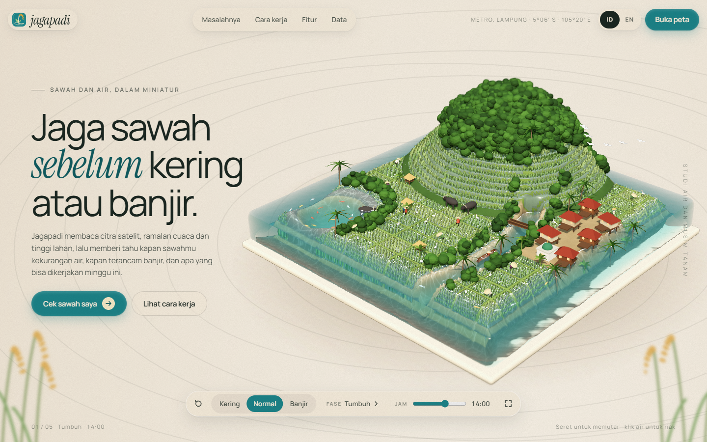

> [!WARNING]
> Jagapadi is a scientific estimation tool, **not an official warning system**. For decisions, follow BMKG, your agricultural extension officer (PPL) and BPBD.

## Contents

1. [Problem](#problem)
2. [Summary](#summary)
3. [Features](#features)
4. [Screens](#screens)
5. [Try it in three steps](#try-it-in-three-steps)
6. [Run locally](#run-locally)
7. [Architecture](#architecture)
8. [Scientific method](#scientific-method)
9. [Validation and limitations](#validation-and-limitations)
10. [Data sources](#data-sources)
11. [API](#api)
12. [Testing](#testing)
13. [Repository structure](#repository-structure)
14. [Other documentation](#other-documentation)
15. [Team](#team)
16. [License and attribution](#license-and-attribution)

## Problem

Indonesian rice farmers usually learn a field is short of water when the soil has already cracked, and learn about a flood when the plots are under water. The signals were visible earlier in satellite images, weather ensembles and river forecasts, but that data does not reach the bund.

- Indonesia's 2023 rice harvested area fell to about 10.21 million ha, **down 2.29%** from 2022, as El Niño strengthened in the second half of the year ([BPS via Bisnis.com, 1 Mar 2024](https://ekonomi.bisnis.com/read/20240301/99/1745543/bps-luas-panen-padi-2023-merosot-229-sepanjang-2023)).
- National rice production in 2023 was 31.10 million tonnes, **about 440,000 tonnes lower** than 2022 ([BPS via Kontan](https://nasional.kontan.co.id/news/produksi-beras-nasional-turun-440000-ton-pada-2023-bps-terdampak-el-nino)).
- In the 2019 dry season, the Ministry of Agriculture recorded **102,746 ha** of rice affected by drought and **9,358 ha** of total crop failure (puso) ([Kementan via detikFinance](https://finance.detik.com/berita-ekonomi-bisnis/d-4616392/9-300-hektare-sawah-gagal-panen)).

## Summary

A farmer or extension officer draws a field on a satellite map. Jagapadi then:

1. reads the field's own **Sentinel-2** history (NDVI greenness, NDWI canopy water, open water) and compares it with the land around it;
2. runs an **FAO-56 paddy water balance** across all **51 ECMWF ensemble** rain scenarios, extended to 30 days with a 10-year ERA5 climatology;
3. checks **river flow** (GloFAS) against the 2-year flood and the field's height above the nearest channel;
4. combines physics and satellite signals into a drought risk, a flood risk and a pest weather-suitability level, each with the reasons behind it;
5. gives ranked, feasible actions, the nearest mapped water source, a scenario simulator, a grounded chatbot and a printable A4 report.

Every number on screen comes from a live source or a calculation from one, with its capture time. When a source fails, the app says which one and why.

## Features

| Feature | What it does |
|---|---|
| Field drawing | Tap the corners of a plot on Esri or Sentinel-2 cloudless imagery; size limits keep analysis fast. |
| Drought outlook | P5/P50/P95 day when water stress starts, daily stress probability, drivers, ranked actions (AWD, bund repair, pumping, mulch, group water rotation). |
| Flood outlook | Ponding depth vs plant height, days of full submergence, GloFAS river ensemble vs the 2-year flood, height above the channel. |
| Pest suitability | Blast, bacterial leaf blight, brown planthopper and stem borer from published favourable ranges; scouting steps, never pesticide doses. |
| Water sources | Rivers, canals, ponds, reservoirs and wells from OpenStreetMap with distance and a line on the map. |
| Scenario simulator | Change rain, delay the rains, add warming, an extreme storm or irrigation; results are stamped **hypothetical**. |
| Day player | Scrub or play 30 days; the field recolours by stress or water depth; a heat strip shows risky days at a glance. |
| Si Padi chatbot | Answers only from the field's analysis via tools, cites sources, says when data is missing; works without an LLM key using templates. |
| Field report | A4 print layout with map snapshot, gauges, charts, actions, pests, water sources, sources and a signature line for the PPL. |
| Offline replay | `JAGAPADI_OFFLINE=1` serves recorded real responses (with capture times) when venue Wi-Fi fails. |
| IoT ingest | `POST /api/sensors/{field}` for an ESP32 soil-moisture and water-level device; sample firmware in `scripts/firmware`. |
| Bilingual | Bahasa Indonesia first, English toggle everywhere, including backend explanations. |

## Screens

**Landing story.** Scrolling plays the diorama through each chapter.

<table>
  <tr>
    <td align="center" width="50%">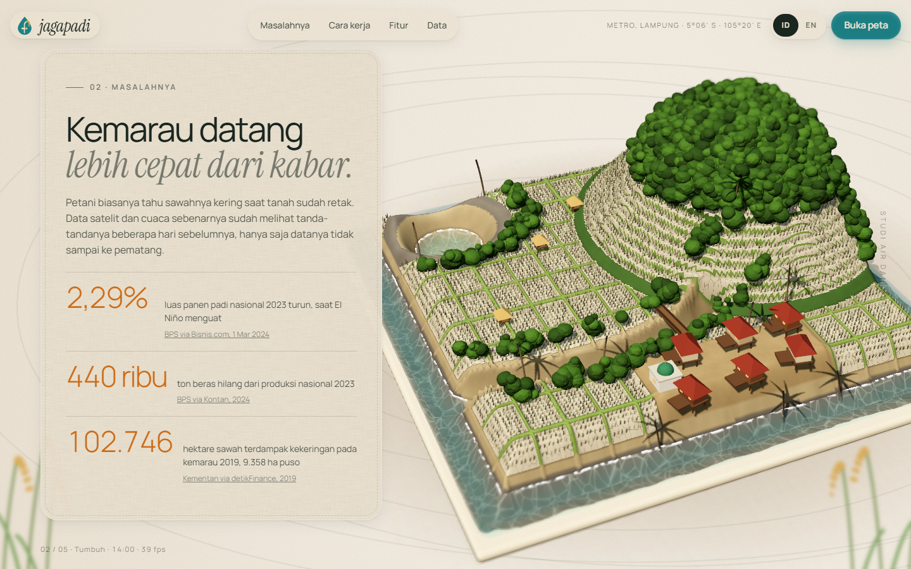<br/><sub>The problem: drought arrives before the news</sub></td>
    <td align="center" width="50%">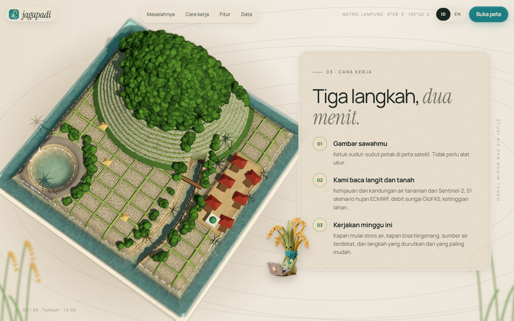<br/><sub>How it works, in three steps</sub></td>
  </tr>
  <tr>
    <td align="center" width="50%">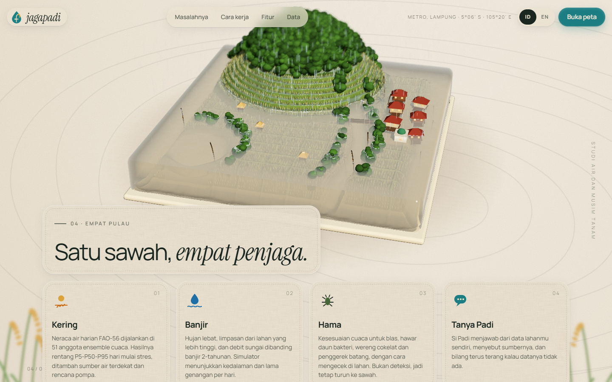<br/><sub>Four guards: drought, flood, pests, Si Padi</sub></td>
    <td align="center" width="50%">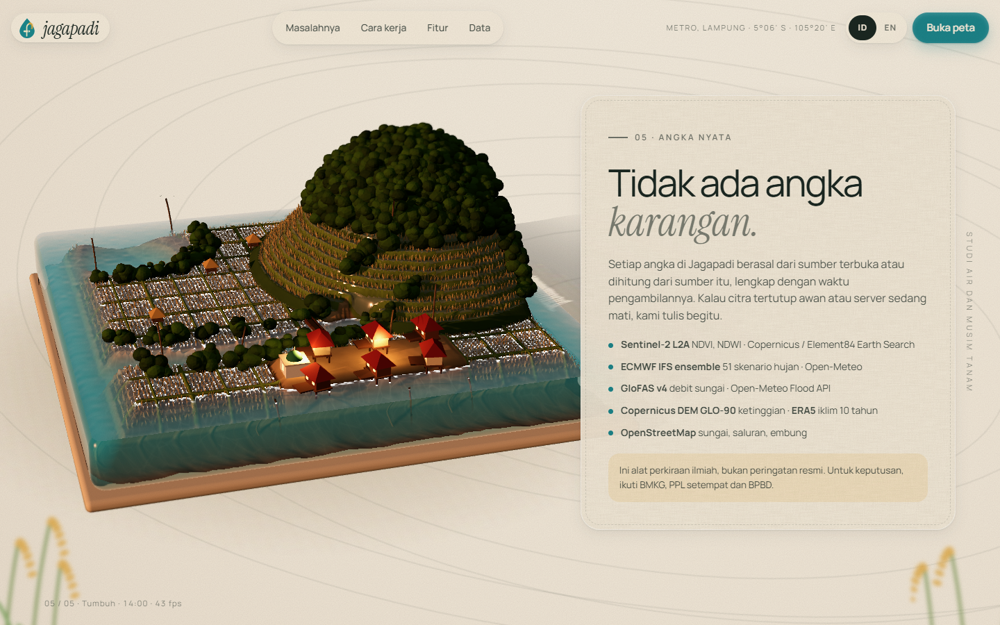<br/><sub>Real data only, at dusk</sub></td>
  </tr>
</table>

**Field workspace.** One field, read from satellite, weather and terrain.

<table>
  <tr>
    <td align="center" width="50%">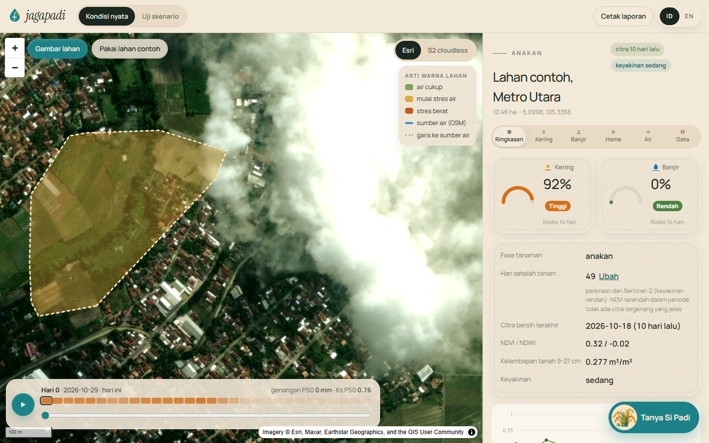<br/><sub>Summary with risk gauges</sub></td>
    <td align="center" width="50%">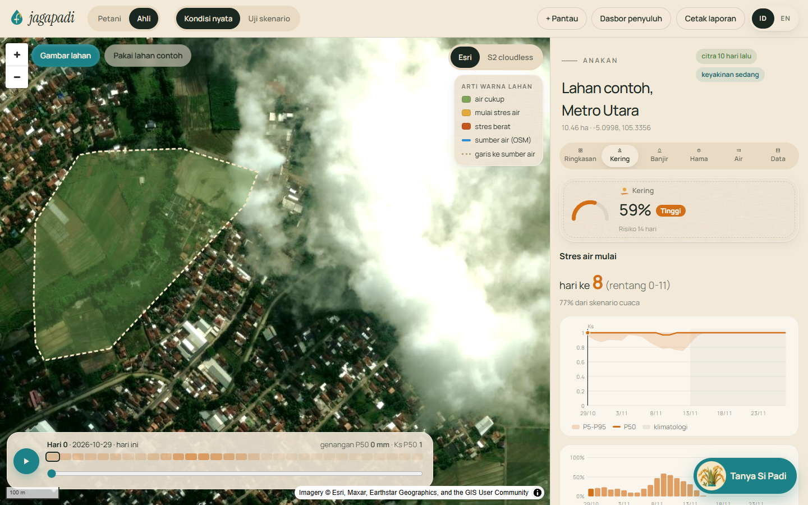<br/><sub>Drought outlook and actions</sub></td>
  </tr>
  <tr>
    <td align="center" width="50%">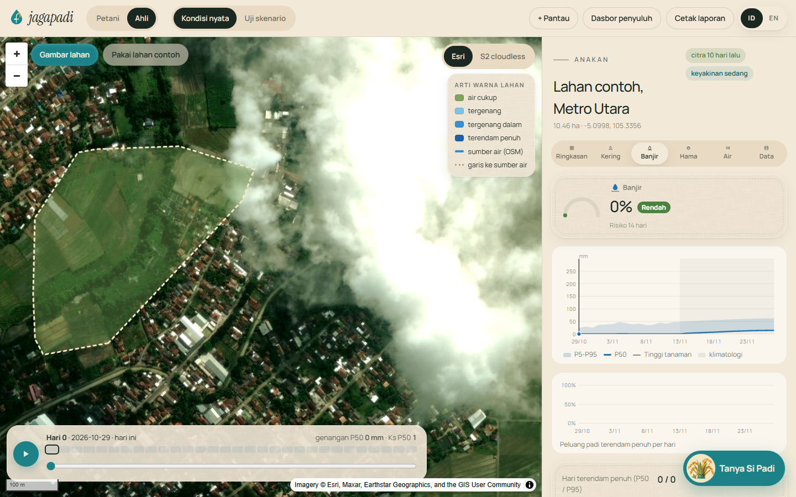<br/><sub>Flood outlook</sub></td>
    <td align="center" width="50%">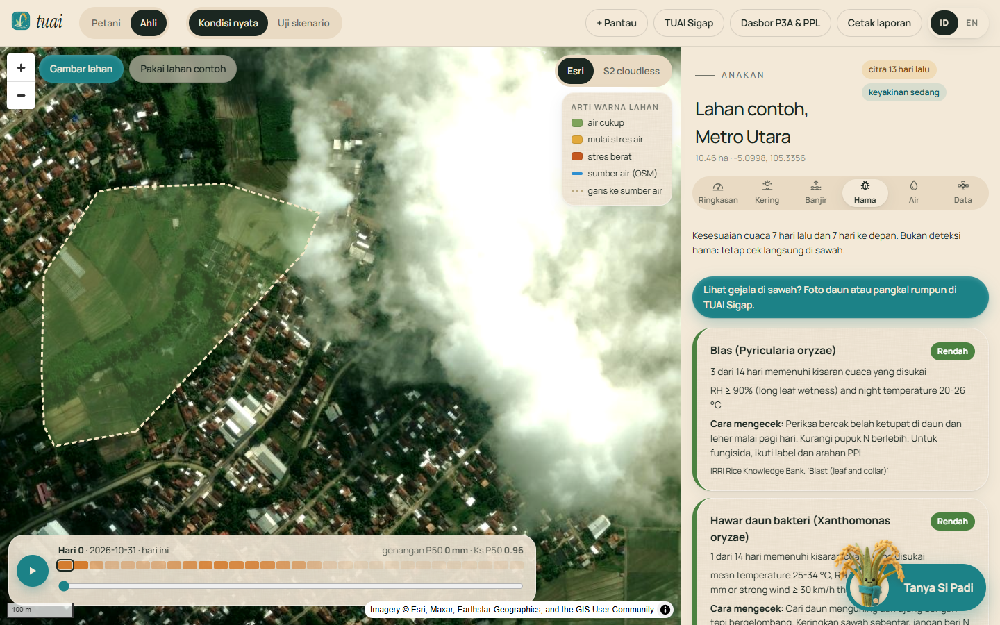<br/><sub>Pest risk</sub></td>
  </tr>
  <tr>
    <td align="center" width="50%">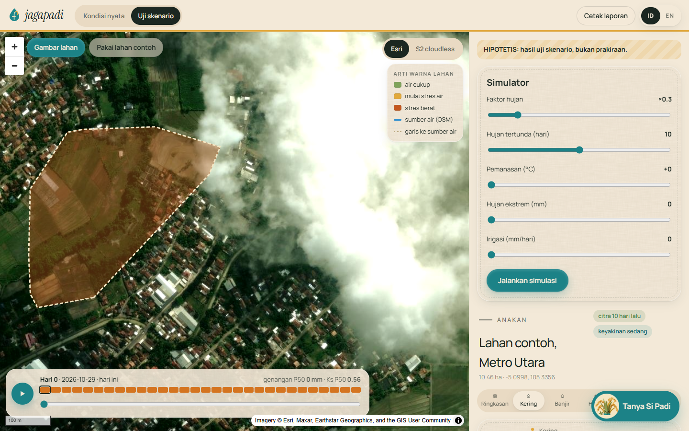<br/><sub>Scenario simulator</sub></td>
    <td align="center" width="50%">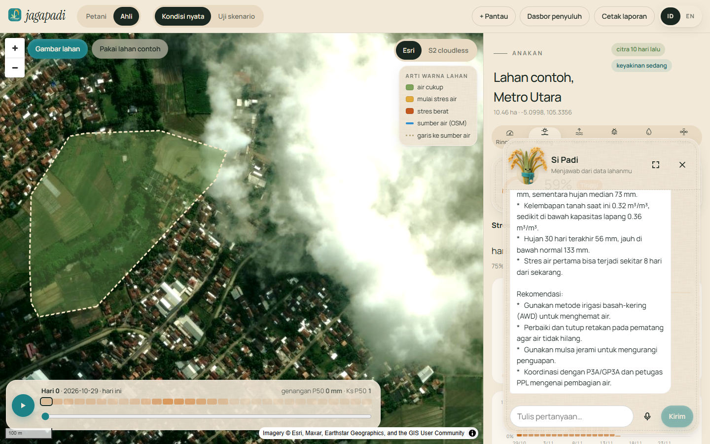<br/><sub>Si Padi chatbot</sub></td>
  </tr>
</table>

**On a phone.**

<table>
  <tr>
    <td align="center" width="50%">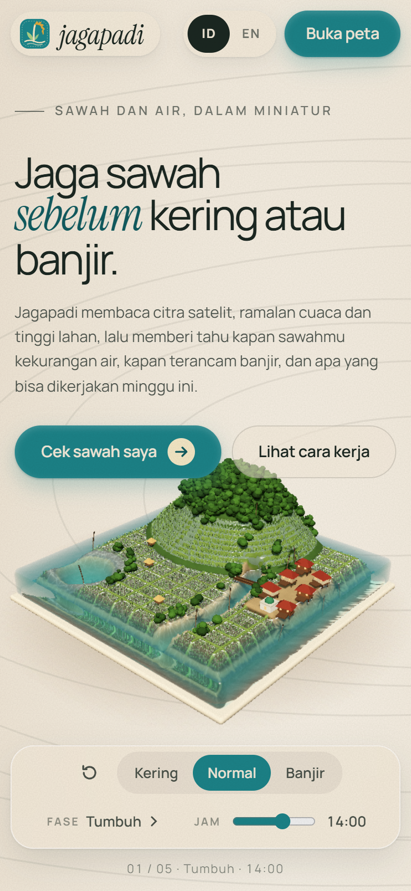<br/><sub>Landing</sub></td>
    <td align="center" width="50%">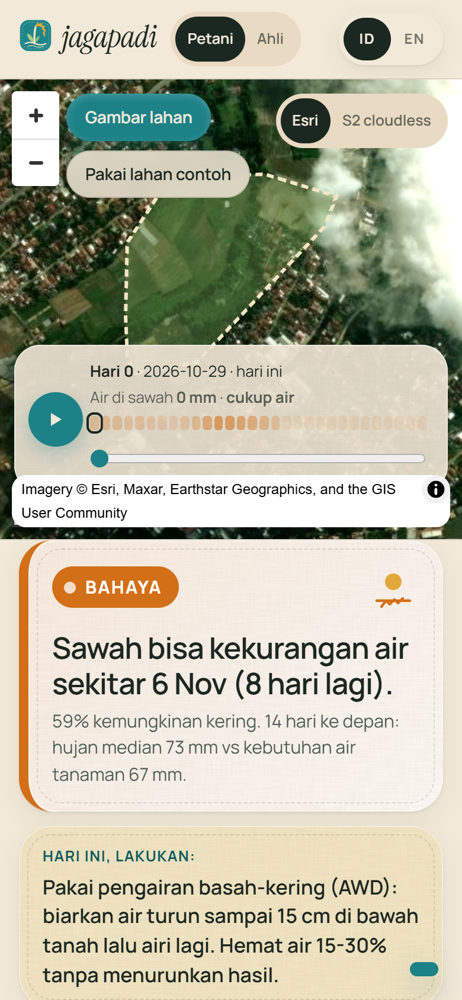<br/><sub>Field workspace</sub></td>
  </tr>
</table>

A sample printed report: [docs/screenshots/laporan-contoh.pdf](docs/screenshots/laporan-contoh.pdf).

## Try it in three steps

1. Open the app and press **Buka peta** (Open map).
2. Press **Pakai lahan contoh** (sample field in Metro Utara) or **Gambar lahan** and tap the corners of your field.
3. Read the Summary, Drought and Flood tabs, play the timeline, then try **Uji skenario** (test scenario) or ask Si Padi.

The first analysis of a field takes about a minute because Sentinel-2 scenes are read live; repeat requests are cached.

## Run locally

Requirements: Python 3.10+, Node 20+.

**One command (both servers)**

```bash
npm run setup     # pip + npm install
npm run dev       # API on :8000, web on :5173
```

**Manual**

```bash
cd backend && pip install -r requirements-dev.txt && python -m uvicorn app.main:app --reload --port 8000
cd frontend && npm install && npm run dev
```

**Docker (production image: web build served by the API)**

```bash
docker compose up --build    # http://localhost:8000
```

**Configuration** (`backend/.env`, copy from `backend/.env.example`; everything is optional)

| Variable | Default | Purpose |
|---|---|---|
| `LLM_PROVIDER` / `LLM_API_KEY` / `LLM_MODEL` | empty / empty / `claude-opus-5-5` | Grounded chatbot through the Anthropic API. Without a key, template answers are used. |
| `OPENWEATHER_API_KEY` | empty | Optional current conditions from OpenWeather. |
| `JAGAPADI_OFFLINE` | `0` | `1` serves only recorded real responses from `backend/data/replay`. |
| `JAGAPADI_RECORD` | `0` | `1` records every live response with its capture time. |
| `JAGAPADI_MAX_FIELD_HA` | `200` | Largest field accepted. |
| `JAGAPADI_CORS` | `http://localhost:5173` | Allowed browser origins for the API. |

## Architecture

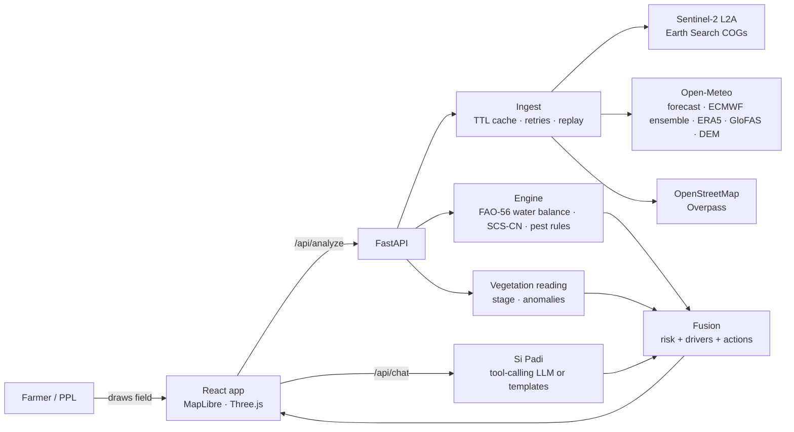

| Layer | Location | Notes |
|---|---|---|
| Landing | `frontend/src/landing` | Procedural diorama (`Diorama.ts`): heightfield terraces, 16k instanced rice plants, water with depth-based absorption, scroll story. |
| App | `frontend/src/app` | Map workspace, drawer tabs, charts, simulator, chatbot, print report. |
| API | `backend/app/main.py` | Analyze, validate, chat, sensors, validation, health; serves the built web app. |
| Ingest | `backend/app/ingest` | One module per source, shared HTTP layer with cache, retries and record/replay. |
| Engine | `backend/app/engine` | Water balance, pests, recommendations, backtest. |
| AI | `backend/app/ai`, `backend/app/llm` | Training-free satellite reading; grounded chat. |

## Scientific method

| Piece | Method | Reference |
|---|---|---|
| Crop water use | ET0 (FAO Penman-Monteith from Open-Meteo) × rice Kc by stage: 1.05 / 1.20 / 0.90 | Allen et al. 1998, FAO-56, Tables 11-12 |
| Paddy water balance | Daily ponding depth over a root-zone bucket; TAW from field capacity and wilting point; stress when depletion exceeds RAW (p = 0.20), Ks per FAO-56 eq. 84; percolation 3 mm/day; outlet and bund heights | FAO-56; FAO Irrigation & Drainage paper 33 |
| Uncertainty | The balance runs once per ECMWF IFS ensemble member (51); P5/P50/P95 and daily probabilities; days 16-30 use the 10-year ERA5 day-of-year mean | ECMWF ENS; ERA5 |
| Runoff from higher ground | SCS curve number (CN 85) scaled by the share of surrounding land higher than the field (DEM) | USDA NRCS TR-55 |
| River flood | GloFAS v4 ensemble discharge vs the 2-year return level (Gumbel fit to 20 years of annual maxima); exposure from field height above the nearest channel (HAND approximation) | Alfieri et al. 2013; Rennó et al. 2008 |
| Submergence | Ponding depth vs stage-dependent plant height; days of full submergence; most varieties tolerate about 4-7 days | IRRI Rice Knowledge Bank |
| Vegetation | Sentinel-2 L2A, SCL cloud mask, NDVI, NDWI (Gao 1996), open water (McFeeters 1996); transplanting date from the last flooded/low-NDVI scene before a sustained rise; anomalies vs neighbours and vs a generic rice NDVI curve | Gao 1996; McFeeters 1996 |
| Fusion | P = 1 − (1 − P_physics)(1 − P_satellite), with satellite signals weighted ≤ 0.3 and listed as drivers | Documented rule, not a trained model |
| Pests | Weather-suitability counts over the last and next 7 days from published favourable ranges | IRRI Rice Knowledge Bank pages per pest |

## Validation and limitations

- **Water-balance consistency check** (`GET /api/validation`): the balance driven only by past rain and ET0 is compared with Open-Meteo's modelled 9-27 cm soil moisture over 60 days. For the demo field on 28 Oct 2026: Pearson r = 0.095, MAE = 0.037 m³/m³. This is model against model, not ground truth, and the weak correlation is reported as measured.
- **Drought and flood event skill: not testable.** There is no field-level record of past stress or inundation for arbitrary fields. Jagapadi does not claim an accuracy it has not measured.
- Paddy ponding at the start is estimated from the open-water fraction of a recent clear scene; with no clear scene it starts at 0 mm (the cautious choice for drought). Irrigation is assumed to be zero unless the user enters it.
- The DEM is 90 m: bunds and small levees are not resolved. GloFAS resolves rivers on a ~5 km grid; canals and ditches are not represented.
- Indonesia is cloudy; usable Sentinel-2 scenes can be weeks apart. Scene age is always shown. Sentinel-1 radar (cloud-proof) is not yet integrated.
- Soil hydraulic values are a clay-loam default, not measured per field (SoilGrids not yet integrated).
- Pest levels are weather suitability, not detection.
- OpenStreetMap coverage of small canals varies, and the public Overpass servers were overloaded during development; the app reports this instead of guessing.

## Data sources

| Source | Used for | Update | Access |
|---|---|---|---|
| Copernicus Sentinel-2 L2A (Element84 Earth Search, AWS Open Data) | NDVI, NDWI, water fraction | 5-day revisit | No key, COG windows |
| Open-Meteo Forecast | Daily weather, ET0, soil moisture | Hourly | No key |
| Open-Meteo Ensemble (ECMWF IFS 0.25°) | 51 rain scenarios, 15 days | 6-hourly | No key |
| Open-Meteo Historical (ERA5) | 10-year climatology | Daily (5-day lag) | No key |
| Open-Meteo Flood (GloFAS v4) | River discharge, ensemble, 20-year history | Daily | No key |
| Open-Meteo Elevation (Copernicus DEM GLO-90) | Terrain, slope, height above channel | Static | No key |
| OpenStreetMap (Overpass) | Water sources | Continuous | No key, ODbL |
| Esri World Imagery / EOX Sentinel-2 cloudless 2023 | Basemaps | Static | Attribution |
| OpenWeather (optional) | Current conditions | 10 min | Free key |

Details, licences and check dates: [backend/docs/SOURCES.md](backend/docs/SOURCES.md).

## API

| Method | Path | Purpose |
|---|---|---|
| GET | `/api/health` | Status of each source, offline/LLM flags |
| GET | `/api/demo-field` | The sample field polygon and its provenance |
| POST | `/api/validate-field` | Check a polygon (shape, size) before analysis |
| POST | `/api/analyze` | Full analysis; optional `days_after_transplant`, `irrigation_mm_day`, `initial_ponding_mm`, `scenario` |
| POST | `/api/chat` | Grounded chatbot over a field's analysis |
| GET | `/api/validation?lat=&lon=` | Water-balance consistency check |
| POST / GET | `/api/sensors/{field_id}` | IoT readings in / out |

Request and response shapes: [backend/docs/API_CONTRACT.md](backend/docs/API_CONTRACT.md).

## Testing

```bash
npm test                        # 15 backend unit tests + ruff
npm run qa                      # 47 end-to-end browser checks (servers must be running)
```

The end-to-end suite drives every feature in Chrome: landing story and dock, language switch, reduced motion, no-WebGL fallback, field drawing (including a rejected tiny field), every tab, timeline, basemap, crop-age edit, scenario mode, chatbot, return-to-landing regressions, and 360 px mobile checks (overflow and tap targets). Results: [docs/VERIFICATION.md](docs/VERIFICATION.md).

## Repository structure

```
├── README.md · README.id.md · DESIGN.md · CREDITS.md · LICENSE
├── Dockerfile · docker-compose.yml · package.json
├── assets/mascot-source/        original mascot photos
├── backend/
│   ├── app/{api,ingest,engine,ai,llm}  main.py services.py config.py
│   ├── config/                  demo field, sensor token example
│   ├── data/replay/             recorded real responses for offline demos
│   ├── docs/                    SOURCES, API_CONTRACT
│   └── tests/
├── frontend/
│   ├── public/{mascot,logo,textures}
│   └── src/{landing,app,components,lib,styles}
├── scripts/                     dev runner, QA, screenshots, mascot cut-out, ESP32 firmware
└── docs/                        decisions, brand, analyses, verification, pitch, demo script, screenshots
```

## Other documentation

[DESIGN.md](DESIGN.md) · [docs/DECISIONS.md](docs/DECISIONS.md) · [docs/BRAND.md](docs/BRAND.md) · [docs/3D_ANALYSIS.md](docs/3D_ANALYSIS.md) · [docs/SIMULATOR_ANALYSIS.md](docs/SIMULATOR_ANALYSIS.md) · [docs/VERIFICATION.md](docs/VERIFICATION.md) · [docs/PITCH_DECK.md](docs/PITCH_DECK.md) · [docs/DEMO_SCRIPT.md](docs/DEMO_SCRIPT.md)

## Team

Hikari Reiziq · Ziddan Habibi · Aryarefman. Supervising lecturer: to be added.

## License and attribution

Code: MIT ([LICENSE](LICENSE)). Mascot artwork belongs to the team. Data and library attributions: [CREDITS.md](CREDITS.md). Contains modified Copernicus Sentinel data. © OpenStreetMap contributors.
