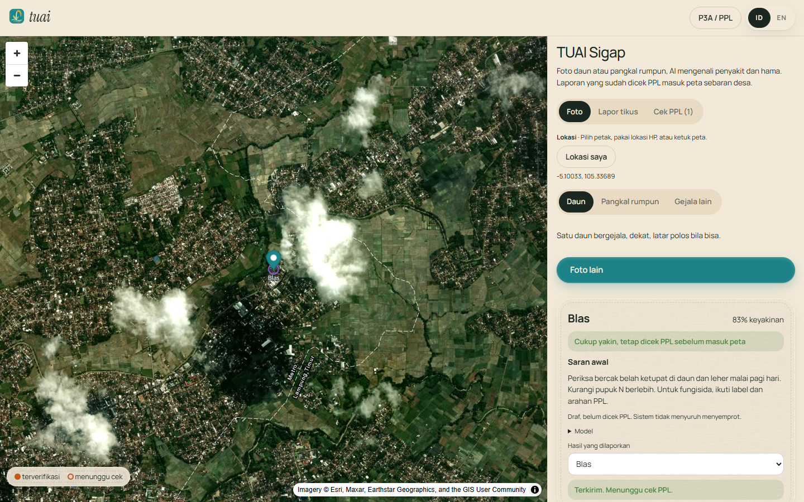
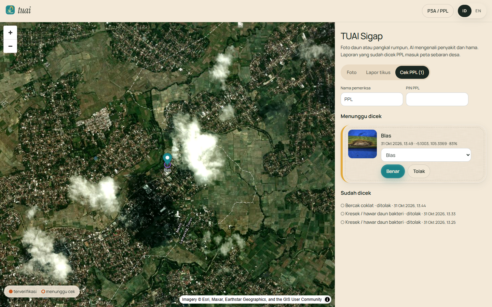
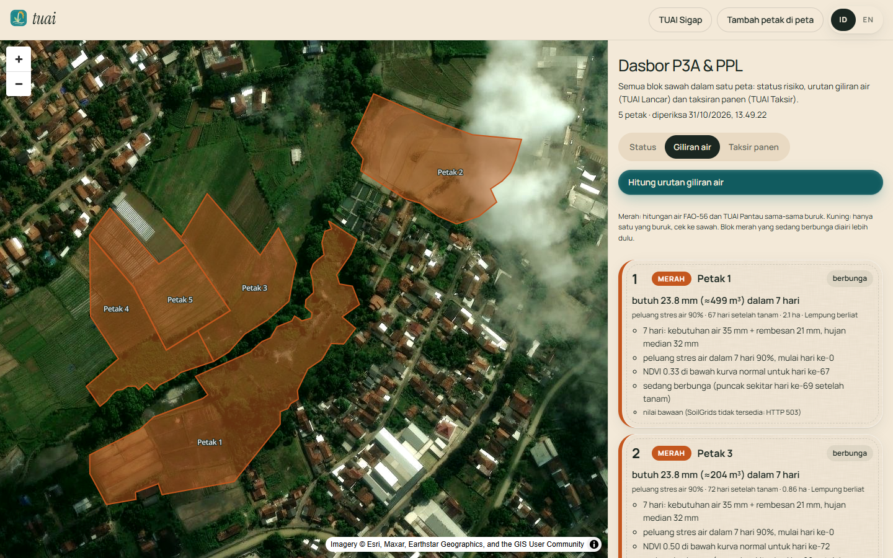
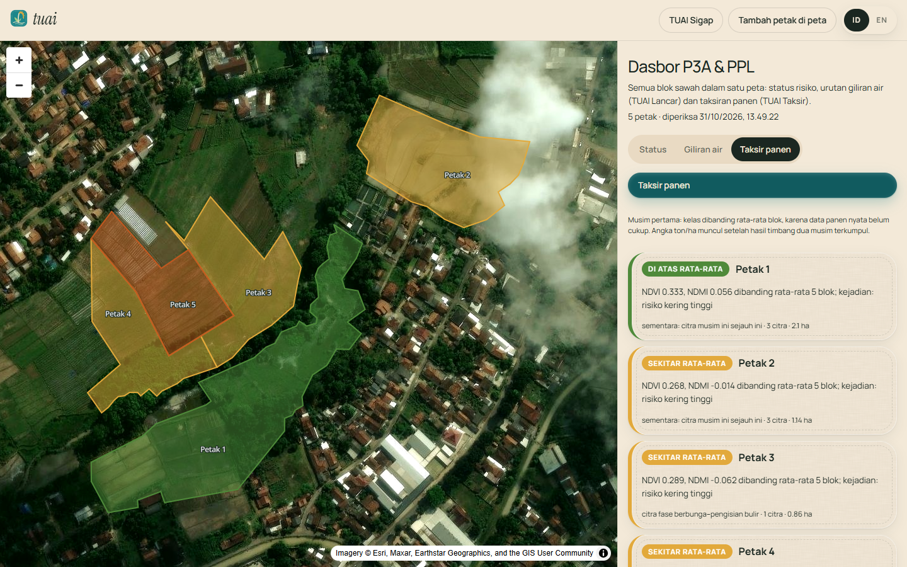
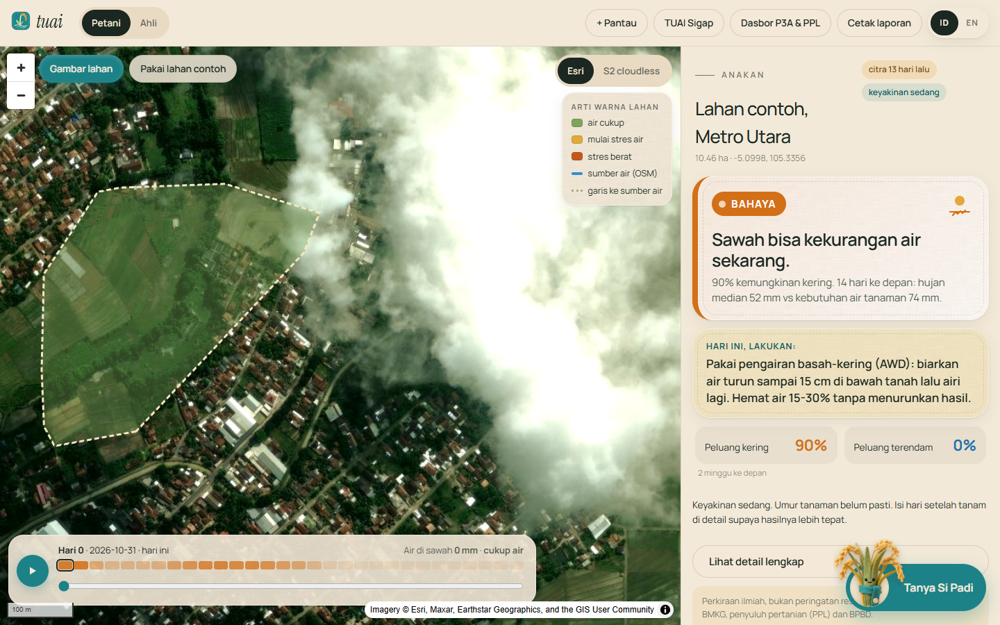
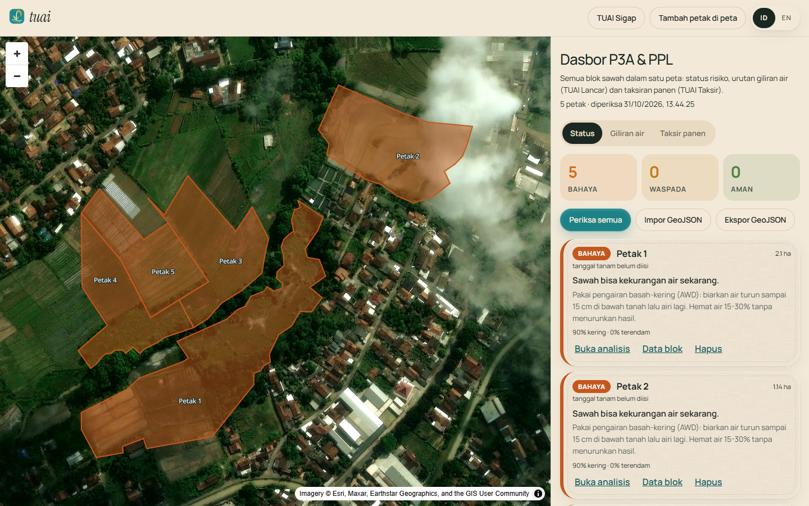
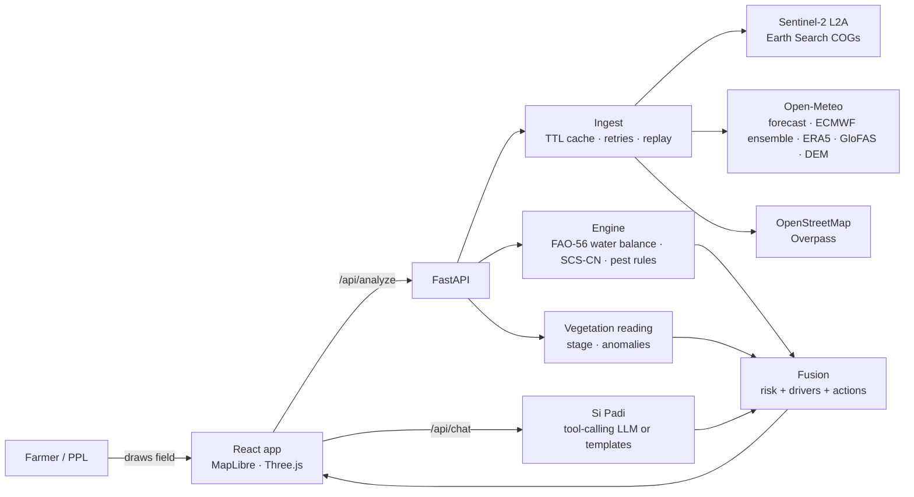

<p align="center">
  <picture>
    <source media="(prefers-color-scheme: dark)" srcset="frontend/public/logo/tuai-lockup-dark.svg" />
    
  </picture>
</p>

<p align="center"><b>Smart rice farming from satellite imagery and computer vision.</b><br/>
Crop monitoring, disease and pest detection, irrigation turns and harvest prediction, on one map per rice block.<br/>
<i>"Tuai" means to harvest rice.</i></p>

<p align="center">Team Infinits · <b>UM Metro Hackathon 2026</b>, sub-theme A · Metro, Lampung, Indonesia</p>

<p align="center">
  
  
  
  
  
  
</p>

<p align="center">
  <a href="#try-it-in-three-steps">Try it</a> ·
  <a href="#run-locally">Run locally</a> ·
  <a href="#scientific-method">Method</a> ·
  <a href="#validation-and-limitations">Limitations</a> ·
  <a href="README.id.md">Bahasa Indonesia</a>
</p>


> [!WARNING]
> TUAI is a scientific estimation tool, **not an official warning system**. For decisions, follow BMKG, your agricultural extension officer (PPL) and BPBD.

## Contents

1. [Problem](#problem)
2. [Summary](#summary)
3. [Features](#features)
4. [Screens](#screens)
5. [Try it in three steps](#try-it-in-three-steps)
6. [Run locally](#run-locally)
7. [Deploy](#deploy)
8. [Architecture](#architecture)
9. [Scientific method](#scientific-method)
10. [Validation and limitations](#validation-and-limitations)
11. [Data sources](#data-sources)
12. [API](#api)
13. [Testing](#testing)
14. [Repository structure](#repository-structure)
15. [Concept alignment](#concept-alignment)
16. [Other documentation](#other-documentation)
17. [Team](#team)
18. [License and attribution](#license-and-attribution)

## Problem

Farmers and water-user groups (P3A) do not know early when, and in which block, their rice is at risk, so action comes too late.

| Focus | Why it is late or hard |
|---|---|
| Drought | Water shortage shows only when the leaves roll. Water turns are shared without data on each block's need. |
| Flooding | Ordinary rice is damaged after about 5 days fully under water. There is no map of which block is flooded and for how long. |
| Disease | Blast, bacterial leaf blight (kresek) and tungro look alike to the untrained eye. |
| Pests | Brown planthoppers are small and live at the stem base; stem borers show only as deadhearts or whiteheads. Pests and diseases get confused, so the wrong product is sprayed. |
| Harvest | The yield is known only at harvest, too late to plan sales, storage or next season's capital. |

National rice data 2024 (Pusdatin Kementan, *Statistik Iklim, OPT dan DPI 2024*, to 11 Oct 2024): flooding hit 172,093 ha (50,142 ha lost), drought 134,440 ha (22,674 ha), stem borer 61,711 ha, blast/blight/tungro 46,826 ha, rats 46,023 ha (1,205 ha lost), brown planthopper 27,058 ha. In Lampung, planthopper attacks rose almost 6× and stem borer almost 2× between 2022 and 2024. Rising pest attacks are the strongest factor in lower paddy yields, odds 9.43 ([Prasetyo & Kadir 2023](https://mpra.ub.uni-muenchen.de/119446/), 50,619 crop-cut plots).

Partner interview (a rice farmer since the 1980s, 3 ha, irrigated): crop failures from rats, planthoppers and drought; *"Gagal panen gaada tanda-tandanya"* (crop failure comes without warning); a normal 6 t/ha harvest fell to 0.3 t/ha in a failed season; no news from government or BMKG.

## Summary

TUAI puts every signal on **one map per rice block, coloured green, yellow or red, with the action to take**. Two sources complement each other: the **satellite** watches the whole area without a field visit (greenness, crop moisture, standing water), and **phone photos** catch what it cannot (disease on the leaf, pests at the stem base).

| Feature | Challenge focus | What it does | Where |
|---|---|---|---|
| **TUAI Pantau** | Crop monitoring | NDVI and NDMI per block from Sentinel-2 against the land around it, growth stage from the planting date | Field page, every block |
| **TUAI Siaga** | Crop monitoring | BMKG rain forecast and Sentinel-1 radar flood mapping (UN-SPIDER change detection): heavy-rain warnings, flooded blocks, days under water | Field page, flood tab |
| **TUAI Sigap** | Disease and pest detection | Photo → AI: 5 leaf classes (blight, blast, brown spot, tungro, healthy), YOLO planthopper count, pest-symptom model; rat quick reports; PPL check; village pest map and warnings for nearby blocks | `/sigap` |
| **TUAI Lancar** | Recommendations for farmers | FAO-56 water need per block, checked against Pantau: red/yellow/green and the order of irrigation for the P3A chair, flowering blocks first; decision log per season | `/ppl` → Water turns |
| **TUAI Taksir** | Harvest prediction | Season one: below/around/above the block average from NDVI/NDMI at flowering to grain filling and recorded events; after two seasons of weighed harvests, linear regression in t/ha with a range | `/ppl` → Harvest estimate |

## Features

| Feature | What it does |
|---|---|
| TUAI Sigap photo check | `/sigap`: photograph a leaf, the base of a hill or another symptom. The leaf model names kresek, blas, bercak coklat, tungro or healthy; the YOLO detector boxes and counts planthoppers; the pest-symptom model names stem borer, hispa or leaf folder. Below 70% confidence, or when models disagree, the result is marked *perlu dicek* for the PPL. First advice is scouting and cultural steps only, marked as a draft until the PPL checks it. |
| TUAI Sigap reports and village map | Photo results and rat quick reports (location, damage level) go to a PPL queue (verify, relabel or reject, optional PIN). Verified reports become points on the village map; two verified planthopper or rat reports within 500 m in a week put a warning on nearby blocks (both numbers configurable, to be tuned in the pilot). |
| TUAI Lancar water turns | `/ppl` → Water turns: the P3A chair fills in each block's transplanting date, variety and soil (or SoilGrids fills the soil). Each block gets its 7-day FAO-56 water need in mm and m³; red when the water count and Pantau are both bad, yellow when only one is (check the field), flowering red blocks first. Decisions and outcomes are logged per season. |
| TUAI Taksir harvest estimate | `/ppl` → Harvest estimate: class against the block average in season one; tonnes per hectare with a range once 8 weighed harvests over 2 seasons are recorded. |
| TUAI Siaga | BMKG's official 3-day forecast for the nearest village with heavy-rain warnings (≥ 50 mm/day), radar flood detection with days under water, and the water-balance submergence forecast. A high Siaga warning lifts a safe verdict to *Waspada*. |
| Farmer view (Petani) | The default screen: one status (**Aman / Waspada / Bahaya**), one sentence on why, and one thing to do today. Charts and probabilities move to the **Ahli** (expert) view. |
| Telegram alerts | One tap links a field to a Telegram chat. Every morning (06:00 WIB) the bot messages while the field is at risk, and once more when it turns safe. `/cek` checks now, `/stop` unsubscribes. |
| Extension officer dashboard | `/ppl`: every plot an officer advises on one map, coloured and ranked by risk. Import or export plot outlines as GeoJSON, open any plot's full analysis. |
| Field drawing | Tap the corners of a plot on Esri or Sentinel-2 cloudless imagery; size limits keep analysis fast. |
| Drought outlook | P5/P50/P95 day when water stress starts, daily stress probability, drivers, ranked actions (AWD, bund repair, pumping, mulch, group water rotation). |
| Flood outlook | Ponding depth vs plant height, days of full submergence, GloFAS river ensemble vs the 2-year flood, height above the channel, and Sentinel-1 radar water (sees through cloud). |
| Pest suitability | Blast, bacterial leaf blight, brown planthopper and stem borer from published favourable ranges; scouting steps, never pesticide doses. |
| Water sources | Rivers, canals, ponds, reservoirs and wells from OpenStreetMap with distance and a line on the map. |
| Scenario simulator | Change rain, delay the rains, add warming, an extreme storm or irrigation; results are stamped **hypothetical**. |
| Day player | Scrub or play 30 days; the field recolours by stress or water depth; a heat strip shows risky days at a glance. |
| Si Padi chatbot | Answers only from the field's analysis via tools, cites sources, says when data is missing. Runs on Claude or Google Gemini (`LLM_PROVIDER`); without a key it answers from templates. |
| Field report | A4 print layout with map snapshot, gauges, charts, actions, pests, water sources, sources and a signature line for the PPL. |
| Offline replay | `JAGAPADI_OFFLINE=1` serves recorded real responses (with capture times) when venue Wi-Fi fails. Recordings still match on later days. |
| IoT ingest | `POST /api/sensors/{field}` for an ESP32 soil-moisture and water-level device; sample firmware in `scripts/firmware`. |
| Bilingual | Bahasa Indonesia first, English toggle everywhere, including backend explanations. |

## Screens

**Landing story.** Scrolling plays the diorama through each chapter: a Lampung rice landscape with farmers in caping hats, egrets, water buffalo, koi in the reservoir and a fisherman's boat, all generated in the browser.

<table>
  <tr>
    <td align="center" width="50%"><br/><sub>The problem: crop failure comes without warning</sub></td>
    <td align="center" width="50%"><br/><sub>How it works: satellite and camera together</sub></td>
  </tr>
  <tr>
    <td align="center" width="50%"><br/><sub>Five features: Pantau, Siaga, Sigap, Lancar, Taksir</sub></td>
    <td align="center" width="50%"><br/><sub>Real data only, at dusk</sub></td>
  </tr>
</table>

**TUAI Sigap, Lancar and Taksir.**

<table>
  <tr>
    <td align="center" width="50%"><br/><sub>TUAI Sigap: leaf photo → blast 83%, draft advice, report sent to the PPL</sub></td>
    <td align="center" width="50%"><br/><sub>TUAI Sigap: PPL review queue</sub></td>
  </tr>
  <tr>
    <td align="center" width="50%"><br/><sub>TUAI Lancar: water-turn order, flowering red blocks first</sub></td>
    <td align="center" width="50%"><br/><sub>TUAI Taksir: harvest class per block (season one)</sub></td>
  </tr>
</table>

The leaf in the Sigap shot is a public-domain Wikimedia Commons photo (`scripts/fixtures`). Refresh every image with `python scripts/capture.py http://localhost:5173 docs/screenshots all`.

**Field workspace.** One field, read from satellite, weather and terrain.

<table>
  <tr>
    <td align="center" width="50%"><br/><sub>Farmer view: one status, one reason, one action</sub></td>
    <td align="center" width="50%"><br/><sub>P3A and PPL dashboard: blocks ranked by risk</sub></td>
  </tr>
  <tr>
    <td align="center" width="50%"><br/><sub>Expert view: summary with risk gauges</sub></td>
    <td align="center" width="50%"><br/><sub>Drought outlook and actions</sub></td>
  </tr>
  <tr>
    <td align="center" width="50%"><br/><sub>TUAI Siaga: BMKG forecast and radar flood check</sub></td>
    <td align="center" width="50%"><br/><sub>Pest weather suitability, with a link to TUAI Sigap</sub></td>
  </tr>
  <tr>
    <td align="center" width="50%"><br/><sub>Scenario simulator</sub></td>
    <td align="center" width="50%"><br/><sub>Si Padi answering with Gemini, from the field's data</sub></td>
  </tr>
</table>

**On a phone.**

<table>
  <tr>
    <td align="center" width="50%"><br/><sub>Landing</sub></td>
    <td align="center" width="50%"><br/><sub>Farmer view</sub></td>
  </tr>
</table>

A sample printed report: [docs/screenshots/laporan-contoh.pdf](docs/screenshots/laporan-contoh.pdf).

## Try it in three steps

1. Open the app and press **Buka peta** (Open map).
2. Press **Pakai lahan contoh** (sample field in Metro Utara) or **Gambar lahan** and tap the corners of your field.
3. Read the status card and today's action. Press **Kirim peringatan ke Telegram** to get it every morning, or **Lihat detail lengkap** for the charts, the scenario simulator and Si Padi.

For a farmer group, open **Dasbor P3A & PPL** (`/ppl`) and press **Pakai contoh kelompok tani**: five real plots from OpenStreetMap, ranked by risk. Open **Data blok** on a plot to enter its transplanting date, variety and soil, then use the **Giliran air** (Lancar) and **Taksir panen** tabs.

For pests and diseases, open **TUAI Sigap** (`/sigap`), take a photo, pick the plot, send the report; the PPL checks it under **Cek PPL**.

A new area takes up to a minute because satellite scenes are read live. Neighbouring plots reuse those pixels and take a few seconds.

## Run locally

Requirements: Python 3.10+, Node 20+.

**One command (both servers)**

```bash
npm run setup     # pip + npm install
npm run dev       # API on :8000, web on :5173
```

**Manual**

```bash
cd backend && pip install -r requirements-dev.txt && python -m uvicorn app.main:app --reload --port 8000
cd frontend && npm install && npm run dev
```

**Docker (production image: web build served by the API)**

```bash
docker compose up --build    # http://localhost:8000
```

**Sigap image models** (optional, about 2 GB with PyTorch):

```bash
pip install -r backend/requirements-ml.txt   # torch, transformers, ultralytics
```

The leaf model downloads from Hugging Face on the first photo. Without these packages the rest of the app runs and Sigap reports each model as unavailable.

**Configuration** (`backend/.env`, copy from `backend/.env.example`; everything is optional)

| Variable | Default | Purpose |
|---|---|---|
| `LLM_PROVIDER` / `LLM_API_KEY` / `LLM_MODEL` | `anthropic` / empty / `claude-opus-5-5` | Grounded chatbot. `anthropic` uses Claude; `gemini` uses Google Gemini (free tier from AI Studio; model defaults to `gemini-3.8-flash`). Same tools and rules either way. Without a key, template answers are used. |
| `OPENWEATHER_API_KEY` | empty | Optional current conditions from OpenWeather. |
| `JAGAPADI_OFFLINE` | `0` | `1` serves only recorded real responses from `backend/data/replay`. |
| `JAGAPADI_RECORD` | `0` | `1` records every live response with its capture time. |
| `TELEGRAM_BOT_TOKEN` | empty | Turns on Telegram alerts. Create a bot with [@BotFather](https://t.me/BotFather) (two minutes) and paste its token. Run a single API worker. |
| `JAGAPADI_ALERT_HOUR` | `6` | Hour (WIB) of the morning alert round. |
| `JAGAPADI_MAX_FIELD_HA` | `200` | Largest field accepted. |
| `JAGAPADI_CORS` | `http://localhost:5173` | Allowed browser origins for the API. |
| `SIGAP_PPL_PIN` | empty | When set, the PPL must enter it to verify or reject Sigap reports. |
| `SIGAP_REVIEW_BELOW` | `0.70` | Model confidence below which a photo result is marked *perlu dicek*. |
| `SIGAP_WARN_RADIUS_M` / `SIGAP_WARN_MIN_REPORTS` / `SIGAP_WARN_DAYS` | `500` / `2` / `7` | Nearby-block warning rule. |
| `ROBOFLOW_API_KEY` / `ROBOFLOW_WERENG_MODEL` | empty | Use the Roboflow hosted planthopper model (`<project>/<version>`) when no local `backend/models/wereng.pt` exists. |

## Deploy

The repository is a [Render](https://render.com) Blueprint: **New → Blueprint →** pick this repo. `render.yaml` builds the Docker image (web app served by the API) and asks for the optional keys. The free plan sleeps after 15 minutes idle, so the first visit takes about a minute and Telegram alerts only run while it is awake. For a demo with doubtful internet, set `JAGAPADI_OFFLINE=1`: the committed recordings cover the sample field and the sample farmer group.

Any host that runs a Docker image works the same way (`PORT` is read from the environment).

## Architecture



| Layer | Location | Notes |
|---|---|---|
| Landing | `frontend/src/landing` | Procedural diorama (`Diorama.ts`): heightfield terraces, up to 22k instanced rice clumps with per-plot growth, flooded paddies, sky light (PMREM), farmers, egrets, buffalo, fish and a flock in flight, water with depth-based absorption, scroll story. |
| App | `frontend/src/app` | Map workspace, drawer tabs, charts, simulator, chatbot, print report. |
| API | `backend/app/main.py` | Analyze, validate, chat, sensors, validation, health; serves the built web app. |
| Ingest | `backend/app/ingest` | One module per source, shared HTTP layer with cache, retries and record/replay. |
| Engine | `backend/app/engine` | Water balance, pests, recommendations, backtest. |
| AI | `backend/app/ai`, `backend/app/llm` | Training-free satellite reading; grounded chat. |

## Scientific method

| Piece | Method | Reference |
|---|---|---|
| Crop water use | ET0 (FAO Penman-Monteith from Open-Meteo) × rice Kc by stage: 1.05 / 1.20 / 0.90 | Allen et al. 1998, FAO-56, Tables 11-12 |
| Paddy water balance | Daily ponding depth over a root-zone bucket; TAW from field capacity and wilting point; stress when depletion exceeds RAW (p = 0.20), Ks per FAO-56 eq. 84; percolation 3 mm/day; outlet and bund heights | FAO-56; FAO Irrigation & Drainage paper 33 |
| Uncertainty | The balance runs once per ECMWF IFS ensemble member (51); P5/P50/P95 and daily probabilities; days 16-30 use the 10-year ERA5 day-of-year mean | ECMWF ENS; ERA5 |
| Runoff from higher ground | SCS curve number (CN 85) scaled by the share of surrounding land higher than the field (DEM) | USDA NRCS TR-55 |
| River flood | GloFAS v4 ensemble discharge vs the 2-year return level (Gumbel fit to 20 years of annual maxima); exposure from field height above the nearest channel (HAND approximation) | Alfieri et al. 2013; Rennó et al. 2008 |
| Submergence | Ponding depth vs stage-dependent plant height; days of full submergence; most varieties tolerate about 4-7 days | IRRI Rice Knowledge Bank |
| Vegetation (TUAI Pantau) | Sentinel-2 L2A, SCL cloud mask, NDVI, NDMI (B8/B11, the same index as Gao 1996 NDWI), open water (McFeeters 1996); transplanting date from the last flooded/low-NDVI scene before a sustained rise; anomalies vs neighbours and vs a generic rice NDVI curve | Gao 1996; McFeeters 1996 |
| Fusion | P = 1 − (1 − P_physics)(1 − P_satellite), with satellite signals weighted ≤ 0.3 and listed as drivers | Documented rule, not a trained model |
| Pests (weather) | Weather-suitability counts over the last and next 7 days from published favourable ranges | IRRI Rice Knowledge Bank pages per pest |
| Flood mapping (TUAI Siaga) | Field-mean VV dB of each pass divided by the median of same-direction passes at least 30 days earlier; > 1.25 is flooded; slopes > 5% ignored; consecutive flooded passes give days under water | UN-SPIDER Recommended Practice (rewritten) |
| Heavy rain (TUAI Siaga) | BMKG 3-hourly `tp` summed per day; BMKG categories: light 0.5-20, moderate 20-50, heavy 50-100, very heavy 100-150, extreme > 150 mm | BMKG |
| Disease and pest photos (TUAI Sigap) | SigLIP2 leaf classifier (5 classes); YOLO planthopper detector; YOLO pest-symptom classifier; *perlu dicek* below 70% confidence or on model disagreement | Wu et al. 2019 (IP102); Petchiammal et al. 2023; Teixeira et al. 2023 |
| Water turns (TUAI Lancar) | 7-day need = Σ ET0·Kc + percolation − median rain − ponding; bad when P(stress within 7 days) ≥ 0.5; flowering window = variety duration − 30 − 21 ± 10 days after transplanting | FAO-56 ch. 6 |
| Harvest (TUAI Taksir) | Season one: z-scores of NDVI and NDMI at flowering to grain filling, minus 0.75 per recorded event relative to the group; then `LinearRegression` on NDVI, NDMI, events with a ±1.28·RMSE band | Jarro-Espinal et al. 2025; Tribuana et al. 2026 |

## Validation and limitations

- **Water-balance consistency check** (`GET /api/validation`): the balance driven only by past rain and ET0 is compared with Open-Meteo's modelled 9-27 cm soil moisture over 60 days. For the demo field on 28 Oct 2026: Pearson r = 0.095, MAE = 0.037 m³/m³. This is model against model, not ground truth, and the weak correlation is reported as measured.
- **Drought hindcast, 2005-2025** ([docs/validation/hindcast-metro-utara.json](docs/validation/hindcast-metro-utara.json)): the water balance runs on ERA5 through every dry-season crop (rainfed, transplanted 1 June and 1 July). Stress days are compared with two indices measured independently by NOAA: ONI (El Niño) and DMI (Indian Ocean Dipole). Rank correlation with ONI 0.64, with DMI 0.74; a random El Niño or positive-IOD year scores higher than a random other year 95% of the time (AUC 0.95). The three worst years it finds, 2015, 2009 and 2019, are all El Niño or IOD+ years; the wettest, 2010 and 2022, are La Niña.
  - What this does **not** show: a plain dry-season rain total scores the same (ONI 0.64, DMI 0.78, AUC 0.95), so at season scale the water balance adds nothing over rainfall. And 2023 ranks only 11th of 21: ERA5 shows 287 mm of June-October rain at this grid point, so the 2023 El Niño is not singled out here.
- **Field-level event skill: not testable yet.** There is no record of past stress or inundation for individual fields. The next step is 5-10 seasons of records from a farmer group or the Metro agriculture office.
- Paddy ponding at the start is estimated from the open-water fraction of a recent clear scene; with no clear scene it starts at 0 mm (the cautious choice for drought). Irrigation is assumed to be zero unless the user enters it.
- The DEM is 90 m: bunds and small levees are not resolved. GloFAS resolves rivers on a ~5 km grid; canals and ditches are not represented.
- Indonesia is cloudy; usable Sentinel-2 scenes can be weeks apart. Scene age is always shown. Sentinel-1 radar fills in the starting water level when the optical scene is older than 12 days, and raises a flood signal only when the surroundings, not the paddy itself, are much wetter than their own history (standing water in a paddy is normal). The −18 dB water threshold is a common literature value, not calibrated for Metro.
- Soil values come from the P3A entry, else SoilGrids (250 m), else a clay-loam default; percolation per texture is an assumption. SoilGrids answered HTTP 503 during development; the app says so and falls back.
- Pest levels on the field page are weather suitability, not detection. Detection is TUAI Sigap, from photos.
- **Sigap leaf model:** two openly licensed Wikimedia Commons photos were read correctly (blast 83%, brown spot 93%), but a plain green square was called brown spot at 99.999%. The model is overconfident on photos that are not rice leaves, so the confidence threshold alone does not catch them. It must be retested on field photos (`scripts/sigap/eval_disease.py`; target F1 ≥ 0.80 per class) before the pilot.
- **Sigap planthopper and pest-symptom models are not trained yet.** The API reports them as unavailable until `backend/models/wereng.pt` and `gejala_hama.pt` exist (`scripts/sigap/train_wereng.py`, `train_gejala.py`) or a Roboflow key is set.
- First advice in Sigap is a draft from IRRI guidance, to be replaced by Kementan guidelines and checked by the PPL.
- Taksir has no harvest data yet, so it gives classes, not tonnes. The Lancar and Taksir thresholds are starting assumptions for the pilot.
- OpenStreetMap coverage of small canals varies, and the public Overpass servers were overloaded during development; the app reports this instead of guessing.

## Data sources

| Source | Used for | Update | Access |
|---|---|---|---|
| BMKG Prakiraan Cuaca Terbuka (`api.bmkg.go.id`) | Official 3-day forecast, heavy-rain warnings (TUAI Siaga) | 3-hourly | No key; cite "Sumber: BMKG" |
| ISRIC SoilGrids 2.0 | Soil texture per block when the P3A leaves it blank (TUAI Lancar) | Static | No key, CC BY 4.0 |
| Hugging Face `prithivMLmods/Rice-Leaf-Disease` | Leaf disease classes (TUAI Sigap) | Pinned revision | Apache-2.0 |
| Roboflow identification-planthopper, IP102, Paddy Doctor | Training data for the planthopper detector and pest-symptom model (scripts/sigap) | Static | CC BY 4.0; IP102 academic only; Paddy Doctor ask the authors |
| Copernicus Sentinel-2 L2A (Element84 Earth Search, AWS Open Data) | NDVI, NDMI, water fraction | 5-day revisit | No key, COG windows |
| Copernicus Sentinel-1 RTC (Microsoft Planetary Computer) | Radar open water through cloud | 6-12 days | No key (anonymous token) |
| NOAA PSL: ONI and DMI | Hindcast check against El Niño and the Indian Ocean Dipole | Monthly | No key |
| Open-Meteo Forecast | Daily weather, ET0, soil moisture | Hourly | No key |
| Open-Meteo Ensemble (ECMWF IFS 0.25°) | 51 rain scenarios, 15 days | 6-hourly | No key |
| Open-Meteo Historical (ERA5) | 10-year climatology | Daily (5-day lag) | No key |
| Open-Meteo Flood (GloFAS v4) | River discharge, ensemble, 20-year history | Daily | No key |
| Open-Meteo Elevation (Copernicus DEM GLO-90) | Terrain, slope, height above channel | Static | No key |
| OpenStreetMap (Overpass) | Water sources | Continuous | No key, ODbL |
| Esri World Imagery / EOX Sentinel-2 cloudless 2023 | Basemaps | Static | Attribution |
| OpenWeather (optional) | Current conditions | 10 min | Free key |

Details, licences and check dates: [backend/docs/SOURCES.md](backend/docs/SOURCES.md).

## API

| Method | Path | Purpose |
|---|---|---|
| GET | `/api/health` | Status of each source, offline/LLM flags |
| GET | `/api/demo-field` | The sample field polygon and its provenance |
| GET | `/api/demo-group` | Five sample plots for the officer dashboard |
| POST | `/api/verdict` | Short form of the analysis: status, reason, today's action, risks |
| POST | `/api/alerts/subscribe` | One-time Telegram link for a field |
| POST | `/api/validate-field` | Check a polygon (shape, size) before analysis |
| POST | `/api/analyze` | Full analysis; optional `days_after_transplant`, `irrigation_mm_day`, `initial_ponding_mm`, `scenario` |
| POST | `/api/chat` | Grounded chatbot over a field's analysis |
| GET | `/api/validation?lat=&lon=` | Water-balance consistency check and the 2005-2025 drought hindcast |
| POST / GET | `/api/sensors/{field_id}` | IoT readings in / out |
| GET | `/api/sigap/status` | Which Sigap models are available, class names and first advice |
| POST | `/api/sigap/analyze` | Photo (data URL) + part (`daun`, `pangkal`, `gejala`) → finding, confidence, *perlu dicek* flag, planthopper boxes, advice |
| POST / GET | `/api/sigap/reports` | Create a photo or rat report / list reports |
| GET | `/api/sigap/reports/{id}/photo` | The stored photo |
| POST | `/api/sigap/reports/{id}/review` | PPL verifies, relabels or rejects (PIN when `SIGAP_PPL_PIN` is set) |
| POST | `/api/sigap/warnings` | Warnings for blocks from nearby verified planthopper or rat reports |
| POST | `/api/lancar/rank` | Water-turn order for a list of blocks |
| POST / GET | `/api/lancar/decisions` | P3A decision log |
| POST | `/api/taksir` | Harvest class or estimate per block |
| POST / GET | `/api/taksir/harvest` | Record / list weighed harvests (training data) |

Request and response shapes: [backend/docs/API_CONTRACT.md](backend/docs/API_CONTRACT.md).

## Testing

```bash
npm test                        # 40 backend unit tests + ruff
npm run qa                      # 72 end-to-end browser checks (servers must be running)
```

The end-to-end suite drives every feature in Chrome: landing story and dock, farmer view and watch button, officer dashboard (sample group, ranking, opening a plot), language switch, reduced motion, no-WebGL fallback, field drawing (including a rejected tiny field), every tab, timeline, basemap, crop-age edit, scenario mode, chatbot, return-to-landing regressions, TUAI block details, Lancar ranking, Taksir rating, Sigap photo → report → PPL review, and 360 px mobile checks (overflow and tap targets). Results: [docs/VERIFICATION.md](docs/VERIFICATION.md).

## Repository structure

```
├── README.md · README.id.md · DESIGN.md · CREDITS.md · LICENSE
├── Dockerfile · docker-compose.yml · package.json
├── assets/mascot-source/        original mascot photos
├── backend/
│   ├── app/{api,ingest,engine,ai,llm,sigap}  main.py services.py blocks.py config.py
│   ├── models/                  trained Sigap weights (not committed)
│   ├── config/                  demo field and group, BMKG village codes, sensor token example
│   ├── data/replay/             recorded real responses for offline demos
│   ├── docs/                    SOURCES, API_CONTRACT
│   └── tests/
├── frontend/
│   ├── public/{mascot,logo,textures}
│   └── src/{landing,app,components,lib,styles}
├── scripts/                     dev runner, QA, screenshots, Sigap training (sigap/), logo set (brand_assets.py), mascot cut-out, ESP32 firmware
└── docs/                        decisions, brand, analyses, verification, pitch, demo script, screenshots
```

## Concept alignment

What the concept paper (*Konsep TUAI Tim Infinits*) specifies, and where the prototype differs on purpose.

| Layer | Concept | Prototype | Why |
|---|---|---|---|
| Satellite processing | Google Earth Engine (Python API) | Sentinel-2 L2A COGs from Earth Search and Sentinel-1 RTC from Planetary Computer, read directly | No account or licence, works offline from recordings; GEE needs a paid licence for commercial use |
| Cloud mask | Cloud Score+ | Sentinel-2 SCL classes | Cloud Score+ is a GEE collection |
| Permanent water, slope masks | JRC Global Surface Water, HydroSHEDS | Neighbour-ring comparison, slope from Copernicus DEM GLO-90 (UN-SPIDER 5% rule) | Same purpose without GEE; JRC still to add |
| Weather | BMKG + Open-Meteo | BMKG 3-day forecast (nearest village code) + Open-Meteo / ECMWF ensemble | As planned |
| Leaf disease | Hugging Face Transformers | `prithivMLmods/Rice-Leaf-Disease`, pinned revision | As planned; must be retested on field photos |
| Pest detection | PyTorch + Ultralytics YOLO | Local `backend/models/wereng.pt` or the Roboflow hosted model | Weights are trained with `scripts/sigap/train_wereng.py`; not shipped |
| Harvest model | scikit-learn | scikit-learn `LinearRegression` | As planned |
| Block database | PostgreSQL + PostGIS | JSON files under `backend/data/{sigap,lancar,taksir}` and blocks in the browser (GeoJSON import/export) | Enough for a pilot of two partners; PostGIS when blocks are shared across devices |
| Web | React PWA + Leaflet | React + MapLibre GL | MapLibre was already in place; not yet installable as a PWA |

## Other documentation

[DESIGN.md](DESIGN.md) · [docs/DECISIONS.md](docs/DECISIONS.md) · [docs/BRAND.md](docs/BRAND.md) · [docs/3D_ANALYSIS.md](docs/3D_ANALYSIS.md) · [docs/SIMULATOR_ANALYSIS.md](docs/SIMULATOR_ANALYSIS.md) · [docs/VERIFICATION.md](docs/VERIFICATION.md) · [docs/PITCH_DECK.md](docs/PITCH_DECK.md) · [docs/DEMO_SCRIPT.md](docs/DEMO_SCRIPT.md)

## Team

Team Infinits, Information Technology, Institut Teknologi Sepuluh Nopember:

- M. Hikari Reiziq Rakhmadinta: team lead, business and downstreaming
- Ahmad Wildan Fawwaz: operations, regulation and proposal
- Muhammad Rakha Hananditya Rauf: AI (Sigap, Pantau, Siaga, Taksir models)
- Arya Bisma Putra Refman: website, backend, block map, water count (Lancar), weather APIs
- Muhammad Ziddan Habibi: user validation and partner liaison
- Supervising lecturer: Prof. Dr. Dedin Finatsiyatull Rosida, STP, MKes

## License and attribution

Code: MIT ([LICENSE](LICENSE)). Mascot artwork belongs to the team. Data and library attributions: [CREDITS.md](CREDITS.md). Contains modified Copernicus Sentinel data. © OpenStreetMap contributors.
