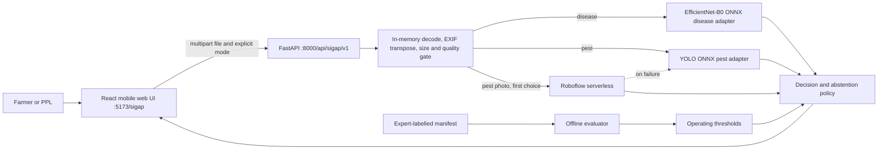

# Architecture

## Shared TUAI foundation

This subsystem is operationally independent, but it is not a separate product identity.
Both TUAI evidence modules use React/TypeScript/Vite in the browser, Python/FastAPI at the
API boundary, Indonesian-first bilingual contracts, explicit unavailable states, mobile
touch targets, and traceable evidence. The CV interface also follows the read-only
design direction of the existing application: warm paper, teal primary actions,
sage/grain/drought semantic colours, Instrument Serif accents, Manrope working text,
stitched felt surfaces, pills, the TUAI rice/water mark, visible focus, and reduced
motion.

The canonical runtime reuses the TUAI shell and local API process. Sigap source and
failure state remain isolated by folder and namespace. See [COHERENCE.md](COHERENCE.md)
for the exact shared-versus-separate contract.

## Boundary

`cv-prototype/` now owns research, model provenance, evaluation, and field-validation
assets. Runtime source lives in the root app's isolated Sigap namespaces. The
conceptual distinction remains intentional:

- the existing product estimates `forecast_suitability` from environmental data;
- this prototype records a `visual_observation` from one submitted photograph.

Those concepts must not be silently combined into one probability. Any future
integration needs an explicit interface and user approval.

## Runtime flow

The user must choose a mode because the models answer different questions and
require different photos. Disease classification examines whole-image leaf
symptoms. Pest detection localizes only three visible insect classes.

## Components

### Frontend

- React, TypeScript, and Vite, optimized for a 360 px viewport.
- Indonesian-first copy with an English toggle.
- Local photo preview and pest-box overlay.
- Text-only observation summaries may persist in the current browser (maximum 20 and
  user-deletable); photos, names, exact locations, accounts, and analytics do not.
- Development UI is `/sigap` on port `5173`; its `/api` requests proxy to port `8000`.

### API and input gate

- FastAPI accepts JPEG, PNG, WebP, and optional HEIC/HEIF.
- It reads at most 12 MiB plus one byte, rejects decompression bombs, caps decoded
  images at 25 megapixels, applies EXIF orientation, and keeps data in memory.
- The shortest side must be 224 px for disease mode and 480 px for pest mode.
- Quality signals explain possible blur/exposure problems; they are not agronomic
  measurements.
- Disease requests require a human confirmation that the subject is one close-up rice
  leaf. This is an explicit input-contract gate, not automatic visual verification.

### Model adapters

- Disease: `Huyt/rice-leaf-disease-efficientnet-b0` at revision
  `a12e09fd765eda2b846836a965e951151a9125f7`, exported to ONNX with a second class-map
  output and run through ONNX Runtime.
- Pest: `underdogquality/yolo11s-pest-detection` at revision
  `b64a9302e50ae089e52b770fe0d054ac77c1c3d8`. A disposable preparation
  environment converts its pickle checkpoint to ONNX. The application runtime
  loads only the ONNX artifact.

Both are lazily loaded. Health remains reachable when an artifact is missing and
reports the exact readiness error. An analysis request never falls back to fake
predictions.

The disease adapter scores the photo and its mirror image, and the decision layer rejects
a result when they disagree. Its class map, the classifier applied to the final 7x7 feature
map, averages to the logit and drives the on-photo highlight.

Pest photos go to Roboflow first when a key is set, and the local ONNX adapter answers if
that fails. Live camera frames reverse the order to save credits. Authentication stays in
a header, and `processing` records which detector answered.

### Decision policy

Raw outputs are always `model_score`, never silently renamed confidence or
probability. Locally calibrated thresholds are read from a frozen, hashed file.
Without adequate calibration, a class remains experimental and the result
abstains even though candidates may be shown for transparent inspection.

Disease acceptance requires both a class-specific top score and score margin.
Pest acceptance requires a class-specific detection threshold. Quality failures
return `retake`; unsupported/uncertain model outputs return `abstain`.

### Evaluation

The evaluator runs offline and never serves user traffic. It owns:

- immutable, non-identifying manifests;
- content/perceptual hashing and group-leakage checks;
- calibration-only threshold selection;
- final-test metrics and aggregate reports;
- explicit `pending`, `not_testable`, `experimental`, and `tested` states.

Private images, participant names, signatures, consent records, and precise
locations stay outside Git.

## Offline behavior and data lifecycle

Preparation downloads and verifies artifacts before the event. After that, the
API and UI must start with networking disabled. Each upload exists only as request
bytes and an in-memory decoded image; references are released after the response.
There is no upload directory or database. A preflight check verifies artifact
hashes and model readiness before the live demo.

## Security and failure behavior

- MIME claims and filenames are not trusted; the decoder identifies content.
- Model absence is a service-readiness error, not a result.
- Oversized compressed data is `413`; unsupported formats are `415`; invalid or
  undecodable inputs are `422`.
- One model never substitutes for the other.
- No result generates a pesticide, dosage, spray schedule, severity estimate, or
  claim that an undetected pest is absent.

